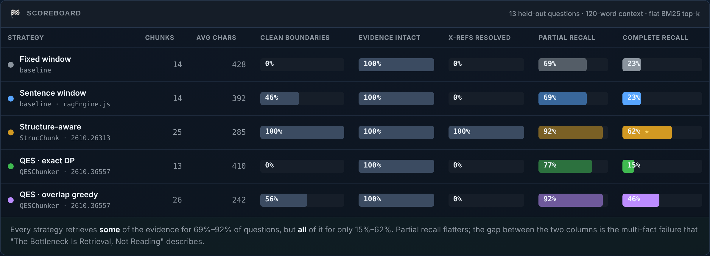
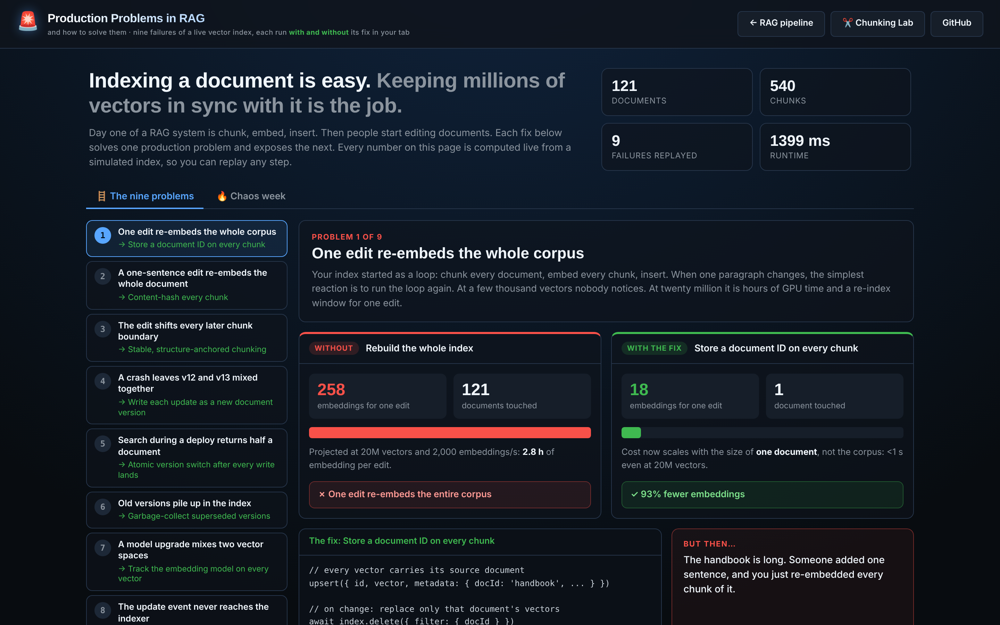

# Advanced Local RAG Demo

> **A fully local, client-side RAG engine that runs entirely in the browser using IndexedDB, WebAssembly, and local vector + keyword indexes. No backend. No database server. Deploys directly to GitHub Pages.**

🔗 **Live Demo:** [https://vishalmysore.github.io/advancedRagDemo/](https://vishalmysore.github.io/advancedRagDemo/)

---

## What is Browser-Native Advanced RAG?

Normally, Retrieval-Augmented Generation (RAG) requires complex backend infrastructures: database servers (like pgvector or Pinecone), document chunkers, embedding microservices, and orchestrator APIs. 

**Advanced Local RAG** demonstrates that a complete, production-grade advanced RAG pipeline can run **entirely inside a browser tab**. By compiling machine learning models into WebAssembly (WASM) using Transformers.js and utilizing IndexedDB (via Dexie.js) as a vector database, this application runs 100% locally on a static site. 

---

## Features

1. **Ingest & Sentence-aware Chunking**: Parses PDFs (using PDF.js) and TXT files, normalizes whitespace and characters, and splits text on sentence boundaries to create overlapping sliding-window chunks.
2. **Local Vector Embeddings**: Downloads and runs the `Xenova/all-MiniLM-L6-v2` embedding model (~90MB) locally in WASM on first run. Subsequent runs load the model instantly from the browser's Cache API.
3. **Custom BM25 Search**: Incremental inverted keyword index stored inside IndexedDB. Computes standard BM25 score TF-IDF normalization formulas for queries.
4. **Hybrid Score Fusion**: Normalizes BM25 and vector similarity scores, combining them via linear weight sliders (e.g. 50% Vector + 50% Keyword).
5. **Two-Stage Reranking**: Collects candidates in Stage 1, then reranks top items in Stage 2 using:
   - *Syntactic Proximity*: Calculates term cluster spacing (checks the smallest word gap containing query keywords).
   - *Neural Cross-Encoder*: Semantic reranking via local `Xenova/ms-marco-MiniLM-L-6-v2` (~90MB).
6. **Interactive Citations**: LLM responses reference sources as `[Source X]`, which the UI parses into interactive badges. Clicking a badge smoothly scrolls to and flash-highlights the source text chunk.
7. **Hallucination Detection Banner**: Post-generation verify checks assertions (numbers, key entities) in the generated response against retrieved chunks. Mismatch terms trigger a visual warning banner.
8. **Continuous Evals**: Calculates real-time metrics locally: Context Relevance, Answer Faithfulness (Groundedness), and Answer Relevance.
9. **Query Cache & memory**: Hashes queries + parameters and caches responses in Dexie to return repeating queries instantly.
10. **Observability Trace Console**: Scrollable terminal trace logging every pipeline step, cosine scores, term frequencies, token count estimates, and latency timings.
11. **Parallel Benchmark Mode**: A side-by-side grid comparing **Vector-Only**, **BM25-Only**, and **Hybrid** retrieval pipelines in real-time, displaying answers, source lists, latencies, and evaluations.
12. **Grounded Mock AI**: Selecting **Mock AI** generates responses grounded in your actual retrieved document chunks locally, allowing you to test the entire RAG pipeline offline with no API key.

---

## ✂️ Chunking Lab (new)

🔗 **Live:** [https://vishalmysore.github.io/advancedRagDemo/chunking.html](https://vishalmysore.github.io/advancedRagDemo/chunking.html)

A second page that compares five chunking strategies from Sept–Oct 2026 research on the same document, retriever and context budget, scored on **complete-evidence recall** (did the context contain *every* fact the question needs?):

| Strategy | Source |
|---|---|
| Fixed window | baseline |
| Sentence window | baseline (same algorithm as `chunkDocument()`) |
| Structure-aware: provision boundaries, heading path, cross-refs resolved | StrucChunk, [arXiv 2610.26313](https://arxiv.org/abs/2610.26313) |
| QES exact DP / QES overlap greedy: supervised by question–evidence pairs | QESChunker, [arXiv 2610.36557](https://arxiv.org/abs/2610.36557) |

Retrieval can be flat BM25 top-k or a **chunk graph** (SpectRAG-lite, [arXiv 2610.36991](https://arxiv.org/abs/2610.36991)): adjacency / provision / cross-ref / lexical edges, personalised PageRank from BM25 seeds, token-budgeted assembly. Views: scoreboard, recall-vs-budget curve, boundary map, per-question inspector, chunk graph. Paste your own markdown + question–evidence JSON to test your documents. No model downloads; everything is in `src/utils/chunkLab.js`.



---

## 🚨 Production Problems in RAG (new)

🔗 **Live:** [https://vishalmysore.github.io/advancedRagDemo/production.html](https://vishalmysore.github.io/advancedRagDemo/production.html)

A third page about what happens after day one: keeping a vector index in sync with documents that keep changing. Nine production failures, each replayed live **without and with** its fix:

| # | Problem | Fix |
|---|---|---|
| 1 | One edit re-embeds the whole corpus | Document ID on every chunk |
| 2 | A one-sentence edit re-embeds the whole document | Content-hash every chunk |
| 3 | The edit shifts every later chunk boundary | Stable, structure-anchored chunking |
| 4 | A crash leaves v12 and v13 mixed together | Write each update as a new document version |
| 5 | Search during a deploy returns half a document | Atomic version switch after every write lands |
| 6 | Old versions pile up in the index | Garbage-collect superseded versions |
| 7 | A model upgrade mixes two vector spaces | Track the embedding model on every vector |
| 8 | The update event never reaches the indexer | Transactional outbox + reconciliation sweep |
| 9 | The answer cache serves yesterday's answer | Key cached answers to source versions |

A **Chaos week** tab replays a scripted week of production (edits, a crash, a deploy, a model upgrade, lost events, a stale cache) against the fixes you switch on and grades the result. Deep links: `production.html?rung=4`, `production.html?tab=chaos&fixes=docIds,hashing,stable,versioning`. Everything is simulated in `src/utils/prodLab.js` (feature-hashed embeddings, in-memory store with an async upsert queue); no model download.



---

## Project Structure

```
src/
├── utils/
│   ├── db.js             # Dexie.js IndexedDB schema (documents, chunks, cache)
│   ├── embeddings.js     # Transformers.js wrapper for embeddings and rerankers
│   ├── bm25.js           # Custom BM25 indexer and scoring retriever
│   ├── pdfParser.js      # PDF.js text extractor
│   ├── llm.js            # Multi-provider LLM caller + CORS proxy wrapper
│   ├── eval.js           # Local evaluation metrics
│   ├── ragEngine.js      # Orchestrates chunking, hybrid search, rerank, and fallback check
│   ├── prodLab.js        # Production Problems simulation: versioned index, 9 failure modes
│   └── prodCorpus.js     # Handbook + knowledge-base corpus for the Production lab
├── index.html            # Dark-mode dashboard layout
├── chunking.html/.js/.css # Chunking Lab page
├── production.html/.js/.css # Production Problems in RAG page
├── styles.css            # Premium glassmorphic stylesheet
└── main.js               # Application coordinator and UI event binder
```

---

## Quick Start

### 1. Clone and Install
```bash
git clone https://github.com/vishalmysore/advancedRagDemo.git
cd advancedRagDemo
npm install
```

### 2. Run Locally
```bash
npm run dev
```

Open `http://localhost:5173` in your browser.

### 3. Demo Offline
* Select **Mock AI** as the provider (no API key needed).
* Drag and drop a sample PDF or TXT file into the ingestion box.
* Ask a question. You will see the local trace logs populate in real-time and a response generated using the text in your uploaded files!

---

## License

This project is licensed under the MIT License - see the [LICENSE](./LICENSE) file for details.
